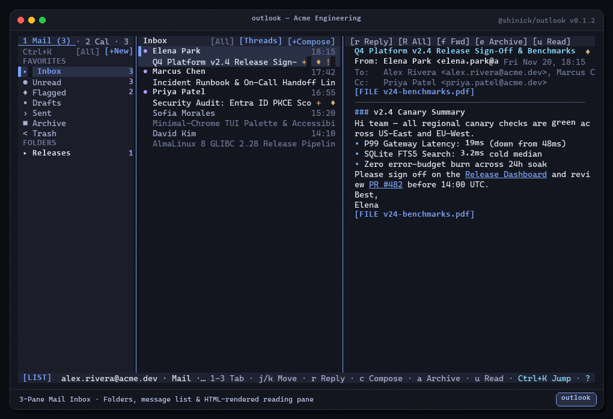

<div align="center">

# `outlook`

**Blazing-fast Microsoft Outlook terminal client & AI agent toolkit — Mail, Calendar, To Do, and Contacts in one native Rust binary.**

[](https://www.npmjs.com/package/@bitefoundry/outlook)
[](docs/NPM.md)
[](https://ratatui.rs)
[](LICENSE)

<br />



</div>

---

## Highlights

| Pillar | What You Get |
| --- | --- |
| **Minimal-Chrome TUI** | 3-tier responsive `ratatui` workspace across **Mail** (`1`), **Calendar** (`2`), and **Microsoft To Do** (`3`) with HTML-rendered email preview, inline `href` toggle (`h`), Link Extractor (`u`), quoted-reply folding (`z`), structured Compose modal (`c`), `zoxide` File Picker (`Ctrl+F`), and `Ctrl+K` Omni-Switcher. |
| **High-Res Terminal Images** | Native inline rendering for attached and `cid:`/`https://` email images across **Kitty**, **iTerm2 (`OSC 1337`)**, **Sixel (`DCS q`)**, and **24-bit Half-Blocks (`▀`)** fallback with live zoom (`+`/`-`/`0`) and protocol cycling (`p`). |
| **Local SQLite FTS5 + IPC Daemon** | Bundled SQLite WAL + FTS5 cache (`cache.db`) with incremental delta sync, `$batch` neighbor hydration, 0ms optimistic triage (`archive`, `flag`, `mark-read`, `complete`), offline search, and sub-5ms CLI reads via `outlook daemon`. |
| **4-in-1 Agent Interface** | One static binary (Windows, macOS, Linux **GLIBC 2.28 / AlmaLinux 8+**) delivers **TUI**, scriptable **CLI (`--json`)**, **Axum HTTP REST API (`outlook serve`, `:3939`)**, and **stdio MCP server (`outlook mcp`, 20 tools)**. |

---

## Quick Start

```bash
# 1. Install globally via npm (links prebuilt native binary, zero Node runtime overhead)
npm i -g @bitefoundry/outlook

# 2. Authenticate with Microsoft Entra ID (or automatically reuse your @bitefoundry/teams M365 session!)
outlook login

# 3. Launch the interactive TUI
outlook
```

> **Shared M365 Session & Token Brokers:** When `share_m365_auth = true` (default), `outlook` seamlessly reuses or upgrades an existing `@bitefoundry/teams` session without a second browser login. Also supports `--device-code`, `OUTLOOK_ACCESS_TOKEN`, `OUTLOOK_TOKEN_FILE`, `OUTLOOK_TOKEN_REFRESH_CMD` (`az account get-access-token`), and custom Entra ID apps. Run `outlook whoami` or `outlook doctor --online` for JWT scope diagnostics, and `outlook update` for one-click SHA-256 verified self-updates.

---

## Keybindings Cheat Sheet

| Key | Context | Action |
| --- | --- | --- |
| `1` / `2` / `3` (`Alt+1..3`) | Global | Switch **Mail** / **Calendar** / **To Do Tasks** tabs |
| `Ctrl+K` | Global | **Omni-Switcher / Command Palette** (`>` commands, `#` folders, `@` contacts, `/` search) |
| `j` / `k` / `↑` / `↓` | Global | Navigate folders, message list, calendar agenda, tasks, or reading pane |
| `Tab` / `Enter` / `Esc` | Global | Cycle pane focus (`Folders ↔ List ↔ Reader`) or close modal |
| `c` / `r` / `R` / `f` | Mail | **Compose** / **Reply** / **Reply-All** / **Forward** (Markdown + `Ctrl+F` attach + `Ctrl+V` image) |
| `e` / `g` / `m` / `Del` | Mail | **Archive** / **Flag** / **Move to folder** / **Delete** (0ms optimistic updates) |
| `h` / `u` / `z` | Mail Reader | Toggle inline `href` URLs / open **Link Extractor** / fold quoted reply history |
| `t` / `F` / `U` | Mail | Toggle **Thread grouping** / **Focused Inbox** / **Unread filter** |
| `v` / `Alt+v` / `d` | Mail Reader | High-res **Inline Image Preview** / download latest attachment (`A` for picker) |
| `n` / `a` / `y` / `x` | Calendar | **New Event** / RSVP **Accept** (`a`), **Tentative** (`y`), **Decline** (`x`) |
| `Space` / `n` | Tasks | Toggle To Do completion (`Space`) / create new task or list (`n`) |
| `/` / `Ctrl+D` / `Ctrl+B` | Global | Search mail (FTS5 + Graph KQL) / toggle **Cozy / Compact** density / toggle sidebar |
| `Ctrl+,` / `?` / `Ctrl+Q` | Global | **Settings** / full help overlay / safe quit |

---

## CLI, HTTP API & MCP

### CLI Examples

```bash
# Mail: inspect inbox, read, reply, and send Markdown with attachments
outlook mail --folder inbox --unread --limit 20 --json
outlook read AAMkAGI2... --mark-read
outlook send --to elena.park@acme.dev --subject "v2.4 Release" \
  --body "**All canary checks passed.** See attached benchmarks." \
  --attach ./v24-benchmarks.pdf --importance high

# Calendar & To Do: view agenda, schedule Teams meeting, RSVP, and manage tasks
outlook calendar --days 7
outlook create-event --subject "Go / No-Go Review" \
  --start "2026-11-20T14:00:00Z" --end "2026-11-20T14:45:00Z" \
  --attendee elena.park@acme.dev --online
outlook add-task "Promote canary to 100%" --due 2026-11-20 --importance high
outlook daemon start
```

### Local HTTP REST API (`outlook serve`)

Start an Axum JSON server on `127.0.0.1:3939` (with live `/openapi.json` and optional `--api-key` auth):

```bash
outlook serve --port 3939
curl http://127.0.0.1:3939/v1/mail/messages?folder=inbox&unread=true
curl -X POST http://127.0.0.1:3939/v1/mail/send \
  -H "Content-Type: application/json" \
  -d '{"to":["elena.park@acme.dev"],"subject":"Build green","markdown":"All checks passed!"}'
```

Full endpoint & schema docs: **[docs/API.md](docs/API.md)** · **[docs/openapi.yaml](docs/openapi.yaml)**

### MCP Server (`outlook mcp`)

Exposes **20 Microsoft Outlook tools** (`whoami`, `list_mail_folders`, `list_messages`, `get_message`, `send_mail`, `reply_mail`, `forward_mail`, `update_message`, `delete_message`, `download_attachment`, `search_mail`, `list_events`, `create_event`, `respond_event`, `delete_event`, `list_todo_lists`, `list_tasks`, `create_task`, `complete_task`, `search_contacts`) over newline-delimited stdio JSON-RPC 2.0:

```bash
# Claude Code
claude mcp add outlook -- outlook mcp
```

```json
// Claude Desktop / Cursor / Windsurf MCP config
{
  "mcpServers": {
    "outlook": {
      "command": "outlook",
      "args": ["mcp"]
    }
  }
}
```

Full tool schemas & client setups: **[docs/MCP.md](docs/MCP.md)** · **[docs/NPM.md](docs/NPM.md)**

---

## `@bitefoundry` Enterprise Terminal Suite

| Package | Command | Domain | Interfaces |
| --- | --- | --- | --- |
| [`@bitefoundry/teams`](https://github.com/BiteFoundry/teams) | `teams` | Microsoft Teams (Chats, Channels, Threads, Presence) | TUI · CLI · HTTP · MCP |
| **`@bitefoundry/outlook`** *(this repo)* | `outlook` | Microsoft Outlook (Mail, Calendar, To Do, Contacts) | TUI · CLI · HTTP · MCP |
| [`@bitefoundry/onenote`](https://github.com/BiteFoundry/onenote) | `onenote` | Microsoft OneNote (Notebooks, Sections, Pages) | TUI · CLI · HTTP · MCP |
| [`@bitefoundry/sharepoint`](https://github.com/BiteFoundry/sharepoint) | `sharepoint` | SharePoint & OneDrive (Sites, Drives, Lists, Files) | TUI · CLI · HTTP · MCP |
| [`@bitefoundry/atlassian`](https://github.com/BiteFoundry/atlassian) | `atlassian` | Jira & Confluence (Issues, Boards, Sprints, Wiki) | TUI · CLI · HTTP · MCP |
| [`@bitefoundry/notion`](https://github.com/BiteFoundry/notion) | `notion` | Notion (Pages, Databases, Blocks, Comments) | TUI · CLI · HTTP · MCP |

---

## License & Disclaimer

Licensed under the [MIT License](LICENSE).

Unofficial terminal client for Microsoft Outlook. Not affiliated with, endorsed by, or sponsored by Microsoft Corporation.
